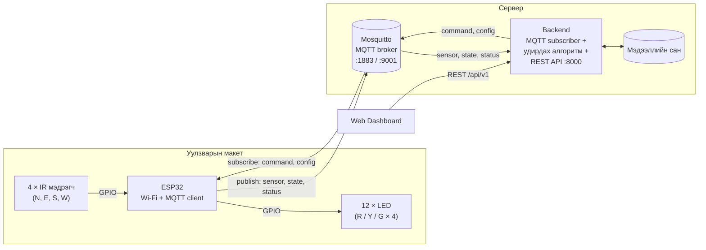

# smart-intersection-mini-system
ESP32 микроконтроллер, мэдрэгч болон MQTT протоколд суурилсан, замын ачааллаас хамаарч гэрлэн дохиог удирдах 4 чиглэлт ухаалаг уулзварын макет систем.

## Систем архитектур



Өгөгдлийн урсгал: **мэдрэгч → ESP32 → `sensor` topic → Backend (алгоритм) → `command` topic → ESP32 → LED**.
Backend эсвэл broker тасарвал ESP32 өөрөө тогтмол хугацаат **fallback** горимд шилжинэ.

## MQTT topic (товч)

| Topic | Чиглэл | QoS / Retain |
|---|---|---|
| `intersection/int01/sensor` | ESP32 → Backend | 0 / үгүй |
| `intersection/int01/state` | ESP32 → Backend | 0 / тийм |
| `intersection/int01/status` | ESP32 → Backend (heartbeat + LWT) | 0 (LWT 1) / тийм |
| `intersection/int01/command` | Backend → ESP32 | 1 / үгүй |
| `intersection/int01/config` | Backend → ESP32 | 1 / тийм |

JSON payload-ын формат ба REST API endpoint-уудын бүрэн тодорхойлолт: **[docs/interfaces.md](docs/interfaces.md)**.

## Фолдерын бүтэц

| Зам | Агуулга |
|---|---|
| [`docs/`](docs/) | Project charter (Typst → PDF), [интерфейс](docs/interfaces.md), [хуваарь ба WBS](docs/schedule.md) |
| [`firmware/`](firmware/README.md) | ESP32 код: [`env_test`](firmware/env_test/) (орчны тест), [`intersection_node`](firmware/intersection_node/) (Wi-Fi + MQTT) |
| [`broker/`](broker/README.md) | Mosquitto тохиргоо, хэрэглэгчийн эрх (ACL), Docker, pub/sub тест |

## Хурдан эхлэх

1. **Broker асаах** — [broker/README.md](broker/README.md):
   ```bash
   cd broker
   docker compose up -d
   ```
2. **ESP32 орчин шалгах** — [firmware/README.md](firmware/README.md) дагуу Arduino IDE, ESP32 core, сангуудыг суулгаж `firmware/env_test`-ийг flash хийнэ.
3. **Уулзварын код** — `firmware/intersection_node/secrets.example.h`-ийг `secrets.h` болгон хуулж, broker-ын IP, нууц үгийг оруулаад flash хийнэ. Анх асахад Wi-Fi тохируулах портал (`SmartIntersection-Setup`) гарч ирнэ.
4. **Урсгал шалгах**:
   ```bash
   python broker/test/pubsub_check.py --host <broker-ip>
   ```
