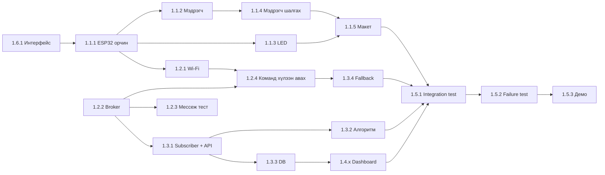

# Хуваарь, WBS ба явцын хяналт

> Issue: [1.6.2] Хуваарь ба явцын хяналт хийх (#2)
> Самбар: [GitHub Projects — Smart Intersection Project Management](https://github.com/users/mjkbtt/projects/3)
> Самбарын талбарууд: `Status`, `Start date`, `Target date`, `Milestone`, `Assignees`, `Labels` (module:*, risk-high)

## 1. Milestone

| Milestone | Агуулга | Хугацаа |
|---|---|---|
| M1 | Архитектур & Шаардлага | 10/01 – 10/05 |
| M2 | Hardware бэлэн болох | 10/06 – 10/19 |
| M3 | MQTT урсгал ажиллах | 10/20 – 10/26 |
| M4 | Удирдлагын логик баталгаажуулах | 10/27 – 11/02 |
| M5 | Dashboard бэлэн болох | 11/03 – 11/09 |
| M6 | Систем туршигдах | 11/10 – 11/16 |
| M7 | Эцсийн демо ба баримт бичиг | 11/17 – 11/23 |

## 2. WBS

| WBS | Ажил | Модуль | Milestone | Хариуцагч | Эрсдэл |
|---|---|---|---|---|---|
| **1.1** | **Hardware** | | | | |
| 1.1.1 | ESP32 тохиргоо ба орчин бэлдэх (#3) | hardware | M2 | 23B1NUM1822 | |
| 1.1.2 | Машин илрүүлэх мэдрэгч суурилуулах (#4) | hardware | M2 | — | high |
| 1.1.3 | LED гэрлэн дохионы хэлхээ холбох (#5) | hardware | M2 | — | |
| 1.1.4 | Мэдрэгчийн өгөгдлийн шалгалт хийх (#6) | hardware | M2 | — | |
| 1.1.5 | Загвар уулзварын макет угсрах (#7) | hardware | M2 | — | |
| **1.2** | **Communication** | | | | |
| 1.2.1 | Wi-Fi холболт автоматаар тохируулах (#8) | communication | M3 | 23B1NUM1822 | |
| 1.2.2 | MQTT broker (Mosquitto) тохируулах (#9) | communication | M3 | 23B1NUM1822 | high |
| 1.2.3 | Мессеж дамжуулалтын тест хийх (#10) | communication | M3 | — | |
| 1.2.4 | ESP32 команд хүлээн авах код бичих (#11) | communication | M3 | — | |
| **1.3** | **Backend** | | | | |
| 1.3.1 | MQTT subscriber ба REST API бичих (#12) | backend | M4 | — | |
| 1.3.2 | Гэрэл удирдах алгоритм хөгжүүлэх (#13) | backend | M4 | mjkbtt | high |
| 1.3.3 | Мэдээллийн сан (DB) зохион байгуулах (#14) | backend | M4 | — | |
| 1.3.4 | Fallback горим (аюулгүйн горим) хийх (#15) | backend | M4 | mjkbtt | |
| **1.4** | **Dashboard** | | | | |
| 1.4.1 | Dashboard бодит хугацааны төлөв хийх (#16) | dashboard | M5 | — | |
| 1.4.2 | Dashboard түүхэн өгөгдөл ба alert хийх (#17) | dashboard | M5 | — | |
| **1.5** | **Testing** | | | | |
| 1.5.1 | Integration test хийх (#18) | testing | M6 | tgldrchn | |
| 1.5.2 | Failure test хийх (#19) | testing | M6 | mjkbtt | |
| 1.5.3 | Эцсийн демо ба баримт бичиг бэлдэх (#20) | testing | M7 | — | |
| **1.6** | **Management** | | | | |
| 1.6.1 | Архитектур ба интерфейс тодорхойлох (#1) | management | M1 | 23B1NUM1822 | |
| 1.6.2 | Хуваарь ба явцын хяналт хийх (#2) | management | M1 | 23B1NUM1822 | |

## 3. Хамаарал (critical path)

## 4. Явцын тэмдэглэл (долоо хоног бүр шинэчилнэ)

Уулзалт бүрийн дараа доор шинэ мөр нэмж, самбарын `Status`-ийг тааруулна.

| Огноо | Долоо хоног | Хийгдсэн | Дараагийн 7 хоног | Саад / эрсдэл |
|---|---|---|---|---|
| 2026-11-05 | M5 | #1 интерфейс (`docs/interfaces.md`), #3 орчны тест sketch, #8 Wi-Fi автомат тохиргоо, #9 broker тохиргоо + pub/sub тест (6/6 PASS) repo-д орсон | ESP32 дээр flash хийж #3 (30 мин), #9 (жинхэнэ ESP32 pub/sub)-ийг баталгаажуулах; #11, #12 эхлүүлэх | Доорх 5-р хэсгийг үзнэ үү |

## 5. Самбар дээр засах шаардлагатай зүйлс

- **Хариуцагчгүй issue 11 ширхэг**: #4, #5, #6, #7, #10, #11, #12, #14, #16, #17, #20 — уулзалтаар хуваарилах.
- **Milestone давхардсан**: `M1`…`M7` ба `M1: …`…`M7: …` гэж хоёр багц үүссэн, дуусах огноо нь 1 өдрөөр зөрүүтэй. Нэгийг нь устгаж issue-уудыг нөгөөд шилжүүлэх.
- **Тайлбар буруу хуулагдсан**: #8 (Wi-Fi)-ийн тайлбар нь #7 (макет)-ийнх, #12 (Subscriber + REST API)-ийн тайлбар нь #11-ийнх. Зөв тайлбар оруулах.
- **Status шинэчлэгдээгүй**: M1–M4-ийн хугацаа өнгөрсөн ч бүх issue `Todo` төлөвтэй байна.
